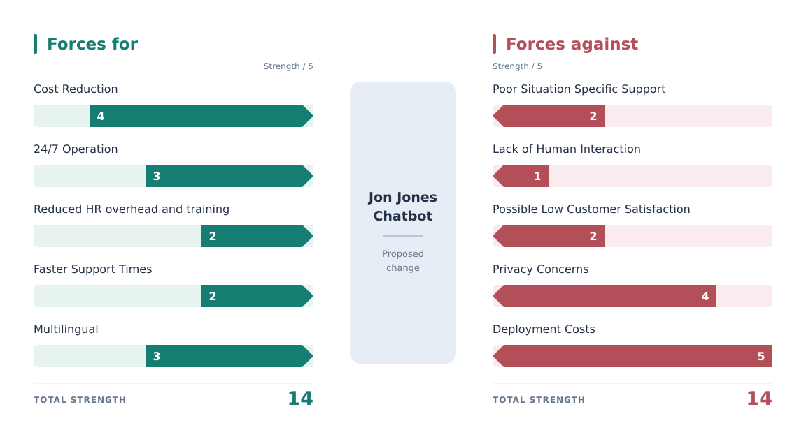

# Buisness Case

The purpose of this document is to outline the buisness case for developing and deploying a customer facing support chatbot at scale. This document will include evaluating the available solutions, estimate their costs and benefits, identify associated risks, and recommend an appropriate approach to achieving the organisation's objectives.

The purpose of this project is to reduce operating costs and streamline the support experience for end users by providing faster assistance. We have 50 human support staff which costs us upwards of £1.15 million per annum. If we can reduce the amount of staff to 10 (80% reduction), we can lower this figure to £185k per annum, not including overhead costs such as office space, equipment and other expenses.

## Management Summary

The current support process relies heavily on manual human support via a dedicated support team, even for the most common routine inquiries. This can result in long wait periods for common questions, limits the availability of support outside of working hours and prevents us from solving more complex customer inquiries.

Through this project, we have an opportunity to reduce overhead costs by delegating the simpler routine support inquries to a lower cost AI support team. This will improve the operating efficiency of the support team and reduce the amount of human staff required.

Alternative options:
- Outsource customer support to a 3rd party call centre
- Asyncronous Visual/Interactive demos
- Direct customers to an FAQ page
- Do nothing

Selected option:
An AI powered chatbot because it provides higher quality responses, has a lower operating margin and allows inhouse support system rather than outsourcing to another company, improving our resilience and reducing external dependencies.

By completing this project, we can build a working client relationship with Johnathon Jones, who operates a multi-million dollar enterprise.

## Description of the Problem and Opportunity

Jon Jones currently employs 50 customer support staff, resulting in significant ongoing staffing expenditure. The client aims to reduce this workforce to 10 employees to lower operating costs while maintaining an effective customer support service.

Many routine customer enquiries are suitable for automation, creating an opportunity to reduce the demand for human support. An AI-powered chatbot could provide faster responses to common enquiries, while directing more complex issues to the remaining support employees.

## Cost Benefit Appraisal

The appraisal covers a five-year period and compares the cost of building and operating the chatbot with the savings from reducing the 50-person support team. The full model is in `Cost Benefit Appraisal.xlsx`; the figures below are taken from that model.

### Costs

| Item | Start-up | Year 1 | Years 2–5 (per year) |
|---|---:|---:|---:|
| Initial development | £15,000.00 | — | — |
| Server hosting | £75.92 | £1,886.04 | £1,886.04 |
| IT administrator | — | £29,205.00 | £29,205.00 |
| AI inference (GPT tokens) | — | £74.41 | £74.41 |
| Monitoring (Grafana Cloud Pro) | — | £335.99 | £335.99 |
| Training and change management | £5,000.00 | £1,000.00 | £1,000.00 |
| Contingency (15% of non-staff operating costs) | £761.39 | £494.47 | £494.47 |
| **Total** | **£20,837.31** | **£32,995.90** | **£32,995.90** |

The five-year cost is **£185,740.90**. The IT administrator accounts for around 88% of annual running costs, while hosting, inference and monitoring together cost less than £2,300 per year. Inference is based on 250 queries per day at 10,000 tokens per query, which works out at approximately £0.0008 per query.

### Benefits

Savings are measured against the current 50-person team at £12.71 per hour, 8 hours per day, 5 days per week and 52 weeks per year (approximately £26,437 per employee per year). The headcount reduction is phased over the appraisal period:

| Year | Support staff remaining | Annual saving |
|---|---:|---:|
| Year 1 | 45 | £132,184 |
| Year 2 | 30 | £528,736 |
| Year 3 | 15 | £925,288 |
| Year 4 | 10 | £1,057,472 |
| Year 5 | 10 | £1,057,472 |
| **Total** | | **£3,701,152** |

### Return on investment

| | Start-up | Year 1 | Year 2 | Year 3 | Year 4 | Year 5 |
|---|---:|---:|---:|---:|---:|---:|
| Net benefit | −£20,837 | £99,188 | £495,740 | £892,292 | £1,024,476 | £1,024,476 |
| Cumulative | −£20,837 | £78,351 | £574,091 | £1,466,383 | £2,490,859 | £3,515,335 |

The project recovers its start-up cost during Year 1, approximately three months after go-live if savings accrue evenly. Over five years the net benefit is **£3.52 million**, a return on investment of approximately **1,893%** against total costs of £185,741.

### Assumptions and sensitivity

- The case depends on the planned headcount reductions being achieved. If displaced staff are redeployed rather than removed, the savings are not realised.
- Redundancy, severance and recruitment costs are not included in the model. These would reduce the net benefit; office, equipment and other overhead savings are also excluded, which offsets this to some extent.
- The IT administrator is the largest recurring cost. If the role is absorbed by existing staff, annual operating costs fall from around £33,000 to around £3,800.
- AI inference cost is highly insensitive to volume at the modelled scale; even a tenfold increase in usage would add less than £700 per year.
- Revenue from improved retention or upselling is not included, so the benefit case is limited to direct cost savings.

## Alternative Options

### Outsource customer support to a 3rd party call centre

- Outsourcing may introduce challenges involving service quality
- Data protection
- Higher operational costs compared to inhouse soloution.
- Call centres might be unavailable during buisness hours (timezone differences)
- customer support experience is more generic and less tailored to our company

## Asyncronous Visual/Interactive demos

- Costly to produce
- Need to be reproduced if a product has a design change
- Not accessible to impared customers
- More suitable for product tutorials rather than general customer support

### Direct customers to an FAQ page

- Too generic to accomodate the unique experience of each customer
- No way to upsell clients on additional support

### Do nothing

- opportunity cost of >~£800k

## Selected Option

Our client has decided to create an AI powered chatbot because it provides higher quality responses, has a lower operating margin and allows us to maintain an inhouse support system rather than outsourcing to another company, improving our resilience and reducing external dependencies.

## Force Field
<!-- 
| for                                         | score | against                            | score |     |
|---------------------------------------------|-------|------------------------------------|-------|-----|
| Cost Reduction                              | 4     | Poor Situation Specific Support    | 2     |     |
| 24/7 operations                             | 3     | Lack of human interaction          | 1     |     |
| reduced HR overhead and training            | 2     | possible low customer satisfaction | 2     |     |
| Faster support turn around time             | 2     | Privacy concerns                   | 4     |     |
| multilingual support (internationalisation) | 3     | development costs                  | 5     | --> |

We can mitigate the impact of development costs by allocationg a portion of the budget as a reserve for any unexpected costs.

In order to address any privacy concerns we can audit the software for regulatory compliace with GDPR, DPA, and ensure we do not log any unnecessary information.

Low situation specific support and lack of human interaction are low impact forces during the inial project scope as we are retaining 10 fallback support staff to handle this specific situation.

## Impacts and Risks

Once the project has been completed, the impacts will be:

- Working environment
The working environment will change significantly as the number of staff will be reduced,  so the remaining staff will work closer together and the culture inside may start to feel as a family.
- Financially
From a financial aspect, there will be a significant amount of money saved, which means that John Jones can use that money in other areas to improve the business. One way could be to raise the salary's of the remaining staff to give them more responsibility, make them work harder and have more disposable income for them to enjoy.
- Quality
The quality of the customer service delivered will change in the positive. This is because any common, simple questions can be answered quickly and with a very trained answer. If there are any other more complicated questions they can be answered by the few experts that still remain, meaning again they will get quality answers.
- Efficiency
The efficiency of the answers delivered once the project is complete will improve because the chatbot will have the answers ready because of all the training that it has been through and can help a customer understand in the optimal way. Whereas if it was a random staff member from the original 50, they will be more versed in certain areas than others, so may not necessarily answer all the questions well.
- Customer satisfaction
The customer satisfaction will definitely be impacted because there will be some people that just want to get straight to the point, meaning they will be more satisfied that the chatbot can quickly answer their questions. However, there will be people that want to feel heard when they have a problem and will appreciate speaking with a human. This is not an issue as John Jones is not as concerned about this part.
- Workload on remaining staff
The workload on the remaining staff will be impacted. It will decrease because the chatbot can be used as a filter to only pass on the few complex questions, meaning that the staff won't have to deal with passing over questions to certain departments and they can just focus on answering the few questions that go to them.

Here are the likely and more important risks with ways to mitigate them:

- Risk of poor software visibility and observability.
Mitigation technique: Create grafana dashboards and utilise them during development.
- Risk of customer requirments changing as the project developes (hidden requirements or incorrect assumptions).
Mitigation technique: Create a signed project brief with scope.
- Risk of not meeting customer requirements.
Mitigation technique: Ensure client is involved in many stages of development.
- Risk of potential security concerns.
Mitigation technique: Ensure we use up to date libraries for security critical code paths and consider security during design.
- Risk of misunderstanding customer requirements
Mitigation technique: Create a signed project brief with scope.

## Conclusions and Recommendations

## Goals

- reduce support costs by reducing human staff headcount
- provide fast and low cost customer support service
- meet compliance goals
