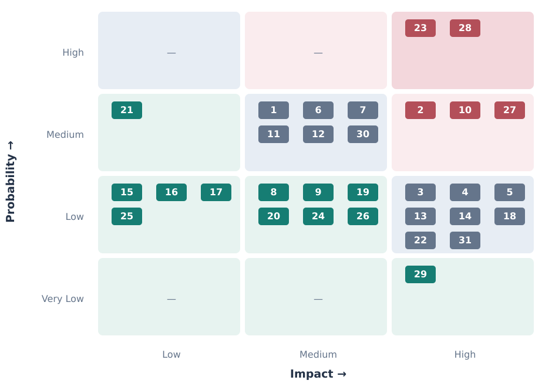

# Risks

## Risk Register

| RiskID | Risk Description                                                                                              | Probability | Impact | Category                     | Response                                                                                                                  |
|--------|---------------------------------------------------------------------------------------------------------------|-------------|--------|------------------------------|---------------------------------------------------------------------------------------------------------------------------|
| 1      | Team might not operate well and achieve the goal                                                              | Medium      | Medium | Team                         | Ensure workplace professionalism standards                                                                                |
| 2      | Risk of not meeting customer requirements                                                                     | Medium      | High   | Requirements                 | Ensure client is involved in many stages of development                                                                   |
| 3      | Risk of poor customer communication                                                                           | Low         | High   | Communication                | Ask clarifying questions with clear answers                                                                               |
| 4      | Risk of budget overrun                                                                                        | Low         | High   | Financial                    | Allocate finanical buffer of 20% of budget                                                                                |
| 5      | Risk of external inference provider outage (openai)                                                           | Low         | High   | Third-party dependency       | Have a failover openai api compatible provider                                                                            |
| 6      | Risk of poor quality answers to client questions                                                              | Medium      | Medium | Quality                      | A/B testing with common issues                                                                                            |
| 7      | Risk of poor quality initial seed data when constructing the answers                                          | Medium      | Medium | Data quality                 | Filter low quality data when building the system, augment data with external LLM                                          |
| 8      | Risk of missing project delivery deadline                                                                     | Low         | Medium | Schedule                     | Allocate buffer for unexpected delays                                                                                     |
| 9      | Risk of artifact delivery and deployment issues or incompatibilities                                          | Low         | Medium | Deployment                   | Use a standardised delivery mechanism (OCI containers)                                                                    |
| 10     | Risk of potential security concerns                                                                           | Medium      | High   | Security                     | Ensure we use up to date libraries for security critical code paths and consider security during design                   |
| 11     | Risk of underestimating the scale of load on the platform                                                     | Medium      | Medium | Performance and scalability  | Load test with an additional margin of RPS, and ensure the platform can scale horizontally across nodes                   |
| 12     | Risk of scope creep and additional features during development                                                | Medium      | Medium | Scope                        | Create and sign a formal project brief with a strict scope                                                                |
| 13     | Risk of missing tooling required to develop project (vscode, neovim etc)                                      | Low         | High   | Development tooling          | Ensure required tools are installed on the developer's computer prior to development                                      |
| 14     | Risk of misallocating work amongst team members                                                               | Low         | High   | Resource management          | Ensure all developers have a similar amount of story points and have work that fits their expertise                       |
| 15     | Risk of openai increasing costs of inference                                                                  | Low         | Low    | Financial                    | Utilise an alternative inference provider/model                                                                           |
| 16     | Risk of server host increasing price of VPS instances (hetzner)                                               | Low         | Low    | Financial                    | Utilise an alternative hosting provider                                                                                   |
| 17     | Risk of outage with external 3rd party VPS provider (hetzner)                                                 | Low         | Low    | Third-party dependency       | Utilise uptime monitoring such as uptime kuma to detect and respond to outages                                            |
| 18     | Risk of potential GDPR violations if people supply personal data                                              | Low         | High   | Compliance                   | Consider GDPR compliance during design and ensure we have a legal contact on the website                                  |
| 19     | Risk of failing to meet accessibility standards                                                               | Low         | Medium | Accessibility                | Consider accesibility during design and use lighthouse testing                                                            |
| 20     | Risk of biased or unrepresentative user testing results                                                       | Low         | Medium | Quality assurance            | Use random samples of users when testing, and ensure a diverse representative sample                                      |
| 21     | Risk of poor database backup implementation                                                                   | Medium      | Low    | Data protection and recovery | Test the backup recovery plan in a staging environment and prior to launch of the application                             |
| 22     | Risk of poor disaster recovery plan                                                                           | Low         | High   | Business continuity          | Test disaster recovery plan with simulated outages                                                                        |
| 23     | Risk of poor software visibility and observability                                                            | High        | High   | Operations                   | Create grafana dashboards and utilise them during development                                                             |
| 24     | Team members might be unavailable do to ilness or external obligations                                        | Low         | Medium | Resource management          | Reallocate work to other team members and utilise the buffer zone                                                         |
| 25     | Staff might lack skills in chosen tech stack (we have placement student as an eng)                            | Low         | Low    | Skills and expertise         | Chose a tech stack we are familiar with                                                                                   |
| 26     | Estimations might be inaccurate                                                                               | Low         | Medium | Planning and estimation      | Utilise the allocated buffer zone to account for any inaccuracies, and use proven estimation models like COCOMO           |
| 27     | Risk of misunderstanding customer requirements                                                                | Medium      | High   | Requirements                 | Create a signed project brief with scope                                                                                  |
| 28     | Risk of customer requirments changing as the project developes (hidden requirements or incorrect assumptions) | High        | High   | Requirements                 | Create a signed project brief with scope                                                                                  |
| 29     | Risk of supply chain attacks on critical dependencies                                                         | Very Low    | High   | Security                     | Only use dependencies with large commerical backing and published > 1 week ago                                            |
| 30     | Risk of software vulnerability in the final artifact                                                          | Medium      | Medium | Security                     | Consider security during design and use best practices during development such as seperation of concerns to reduce impact |
| 31     | Risk of vulnerability in the underlying VPS software                                                          | Low         | High   | Security                     | Ensure the VPS operating system is up to date when setting up the server, and use rootless docker deployments             |

## Risk Map

## RAID Log

### Risks

see above

### Assumptions

- AI inference provider will remain available for the duration of the project
- AI inference provider will continue to expose a compatible API for the duration of the project
- server host is reliable and will not have major outages during the deployment of the project
- Software team will not have a major illness during the development portion of the project
- there will be no large scale socioeconomic changes during the duration of the project (covid pandemic, long term power grid instability)
- customer will be available to provide timely input and feedback during development
- no sudden legislative changes will impact the project
- our developer staff will not seek to terminate their employment until the project has completed
- the client follows through on their commitment to provide seed data, and that seed data is in a computationally readable format

### Issues

### Dependencies

- server hosting provider
- AI inference provider
